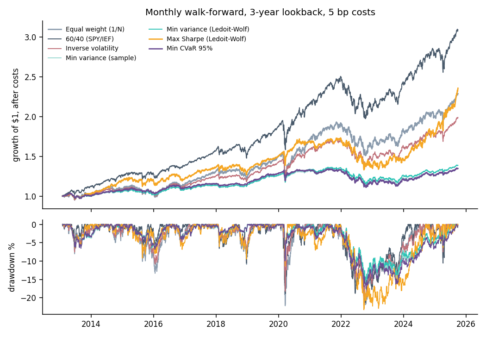
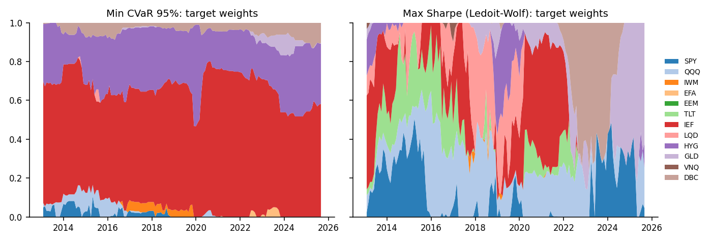
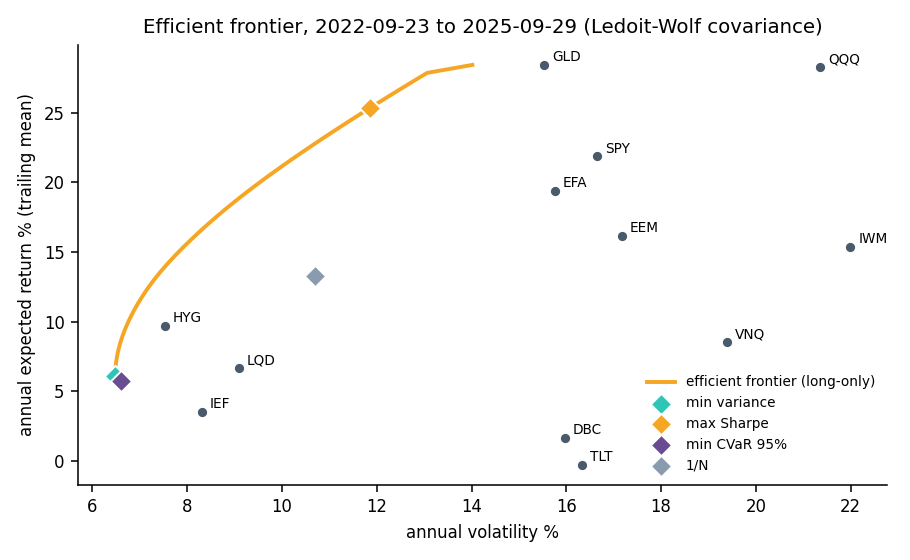

# Mean-variance and CVaR portfolio optimisation, tested walk-forward

Builds long-only portfolio optimisers from scratch (minimum variance, maximum Sharpe and the
efficient frontier, plus **minimum CVaR** as the Rockafellar–Uryasev linear program) and asks
the question that matters: do they beat simple rules **out of sample**? Twelve ETFs across
asset classes, monthly rebalancing on a trailing 3-year window, 5 bp costs, February 2013 to
September 2025.



## Results (Feb 2013 to Sep 2025, after costs)

| Rule | CAGR | Volatility | Sharpe | Max drawdown | Daily CVaR 95% | Turnover / yr |
| --- | --- | --- | --- | --- | --- | --- |
| 60/40 (SPY/IEF) | 9.3% | 10.0% | 0.94 | −21.3% | 1.51% | 27% |
| Max Sharpe (Ledoit–Wolf) | 7.0% | 9.7% | 0.75 | −23.3% | 1.49% | 345% |
| Equal weight (1/N) | 6.8% | 10.2% | 0.70 | −22.2% | 1.50% | 35% |
| Inverse volatility | 5.6% | 8.1% | 0.71 | −20.4% | 1.19% | 35% |
| Min variance (Ledoit–Wolf) | 2.6% | 5.2% | 0.52 | −15.8% | 0.78% | 73% |
| Min variance (sample) | 2.4% | 5.2% | 0.48 | −16.5% | 0.78% | 59% |
| Min CVaR 95% | 2.4% | 5.3% | 0.47 | −17.5% | 0.79% | 75% |

Sharpe ratios use a zero risk-free rate; the ranking is what matters.

**What the numbers say**

- **The risk optimisers do exactly what they promise.** Minimum variance and minimum CVaR
  halve volatility and daily tail loss (CVaR 0.78% vs 1.5%) and cut the worst drawdown by about
  a quarter. They get there by holding mostly intermediate Treasuries and high-yield credit
  (min CVaR averages 62% IEF and 27% HYG), so they also earn far less.
- **Maximum Sharpe barely beats 1/N** (0.75 vs 0.70) while trading ten times as much. Expected
  returns estimated from three years of data are so noisy that the optimiser mostly chases them:
  its weights swing from Nasdaq to Treasuries to commodities to gold (below). This is the
  well-known result of DeMiguel, Garlappi & Uppal (2009).
- **60/40 tops the table** because US stocks dominated this particular decade. Choosing it from
  this table would be hindsight, not skill.
- **Ledoit–Wolf shrinkage helps a little** (min-variance Sharpe 0.52 vs 0.48, shallower drawdown).
- **2022 was the stress test.** Stocks and bonds fell together, so the "safest" portfolios still
  lost 12 to 13% that year; a covariance estimated on the past did not anticipate the
  stock-bond correlation turning positive.





## How it works

| Module | What it does |
| --- | --- |
| `optim/data.py` | 12-ETF universe (US, international and EM equity, Treasuries, IG and HY credit, gold, REITs, commodities), cached prices |
| `optim/optimizers.py` | Minimum variance, maximum Sharpe, target-return frontier (SLSQP); minimum CVaR as a linear program (HiGHS); historical CVaR |
| `optim/estimators.py` | Sample covariance and Ledoit–Wolf shrinkage toward a scaled identity |
| `optim/backtest.py` | Monthly walk-forward: rules see only the trailing window, trades pay costs, weights drift between rebalances |
| `scripts/compare.py` | Runs every rule and writes `docs/comparison.csv` |
| `scripts/report.py` | Charts in `docs/` |

**Minimum CVaR as a linear program.** CVaR at 95% is the average loss on the worst 5% of days.
Rockafellar & Uryasev (2000) showed that, over historical scenarios r₁…r_T, minimising it is

```
minimise    ζ + 1/((1−α)T) · Σ u_t
subject to  u_t ≥ −r_t·w − ζ,  u_t ≥ 0,  Σw = 1,  0 ≤ w ≤ 1
```

one constraint per day, and ζ ends up as the value at risk. A 3-year window is a 756-constraint LP
that HiGHS solves in milliseconds.

## Testing

15 tests (`pytest -q`):
- Minimum variance gives inverse-variance weights for uncorrelated assets; weights respect the budget, long-only and cap constraints
- Maximum Sharpe matches the analytic tangency portfolio when no constraint binds
- The CVaR linear program **beats every point on a 1,001-step brute-force weight grid**
- Ledoit–Wolf shrinks more on shorter samples, lowers estimation error and improves conditioning
- The backtest never lets a rule see future data, charges exactly turnover × cost, and lets weights drift

## Limitations

- **Historical scenarios only.** CVaR is estimated from the trailing three years, so it cannot
  anticipate a crisis unlike anything in the window (2022 is the example).
- **Sample means** drive the maximum Sharpe portfolio. Shrinking expected returns (Black–Litterman,
  or James–Stein toward the grand mean) is the obvious next step.
- **Survivorship.** The ETFs all exist today; the universe was chosen with knowledge of the period.
- **Flat 5 bp costs**, no taxes, monthly close-to-close rebalancing.

## Next steps

- Black–Litterman expected returns, and a turnover penalty in the objective
- Mean–CVaR frontier and CVaR with a return floor (already supported by `min_cvar(min_return=...)`)
- Risk parity (equal risk contribution) as another baseline

## Run it

```bash
python3 -m venv .venv && source .venv/bin/activate
pip install -r requirements.txt
pytest -q
PYTHONPATH=. python scripts/compare.py
PYTHONPATH=. python scripts/report.py
```

## References

- Markowitz, H. (1952). *Portfolio selection.* Journal of Finance.
- Rockafellar, R. T. and Uryasev, S. (2000). *Optimization of conditional value-at-risk.* Journal of Risk.
- Ledoit, O. and Wolf, M. (2004). *A well-conditioned estimator for large-dimensional covariance matrices.* Journal of Multivariate Analysis.
- DeMiguel, V., Garlappi, L. and Uppal, R. (2009). *Optimal versus naive diversification: how inefficient is the 1/N portfolio strategy?* Review of Financial Studies.

---

Yuvraj Chawla · M.S. Quantitative Finance, Northeastern University · [yuvrajchawla.si](https://yuvrajchawla.si)
